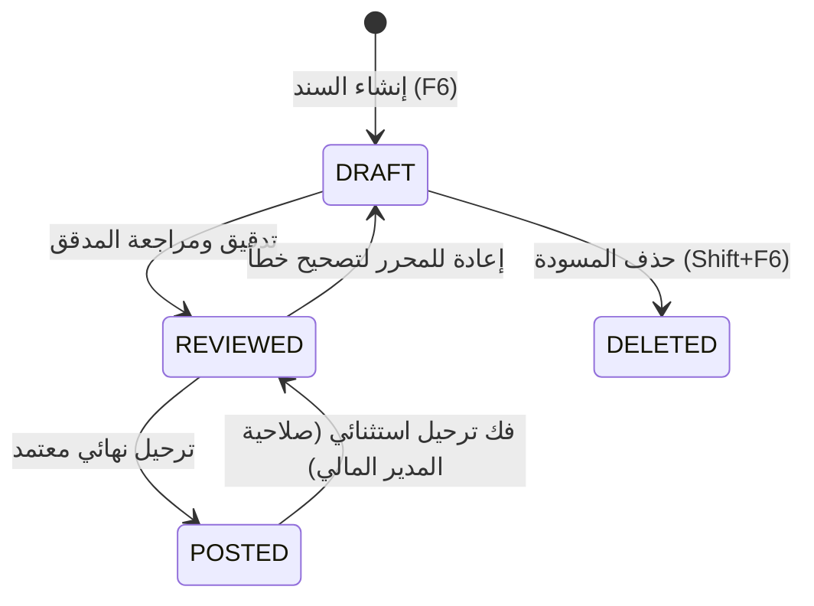

# 📖 دليل النظام الشامل | Al-ParatY Financial Enterprise
## وثيقة التوثيق الهندسي، المحاسبي، والتشغيلي المتكامل لنظام البرطي المالي الشامل

---

## 📑 فهرس المحتويات
1. [الهوية الرسمية والرؤية العامة للنظام](#1-الهوية-الرسمية-والرؤية-العامة-للنظام)
2. [المعمارية البرمجية وهيكلية الملفات](#2-المعمارية-البرمجية-وهيكلية-الملفات)
3. [دليل التثبيت والإعداد والتشغيل](#3-دليل-التثبيت-والإعداد-والتشغيل)
4. [لوحة المفاتيح واختصارات أونكس برو القياسية](#4-لوحة-المفاتيح-واختصارات-أونكس-برو-القياسية)
5. [توثيق الوحدات والشاشات الوظيفية (18 شاشة)](#5-توثيق-الوحدات-والشاشات-الوظيفية)
   - [5.1 لوحة المؤشرات (Dashboard)](#51-لوحة-المؤشرات-dashboard)
   - [5.2 تهيئة النظام والفترات والعملات (System Config)](#52-تهيئة-النظام-والفترات-والعملات-system-config)
   - [5.3 المستخدمون وإدارة الصلاحيات (Security & Users)](#53-المستخدمون-وإدارة-الصلاحيات-security--users)
   - [5.4 الدليل المحاسبي وشجرة الحسابات (Chart of Accounts - COA)](#54-الدليل-المحاسبي-وشجرة-الحسابات-chart-of-accounts---coa)
   - [5.5 الأرصدة الافتتاحية واحتساب رأس المال (Opening Balances)](#55-الأرصدة-الافتتاحية-واحتساب-رأس-المال-opening-balances)
   - [5.6 القيود اليومية العامة (Journal Entries)](#56-القيود-اليومية-العامة-journal-entries)
   - [5.7 سندات الصرف والقبض النقدية (Cash Vouchers)](#57-سندات-الصرف-والقبض-النقدية-cash-vouchers)
   - [5.8 سندات الشيكات والبنك الوسيط (Cheque Vouchers)](#58-سندات-الشيكات-والبنك-الوسيط-cheque-vouchers)
   - [5.9 شاشة التحصيل اليدوي للشيكات (Cheque Collection)](#59-شاشة-التحصيل-اليدوي-للشيكات-cheque-collection)
   - [5.10 نظام المصروفات والنثريات المتكامل (Expenses Module)](#510-نظام-المصروفات-والنثريات-المتكامل-expenses-module)
   - [5.11 الأصول الثابتة وإهلاكها (Fixed Assets)](#511-الأصول-الثابتة-وإهلاكها-fixed-assets)
   - [5.12 المرتبات والأجور (Payroll & HR)](#512-المرتبات-والأجور-payroll--hr)
   - [5.13 الهيكل الإداري وجدول إكسل الإلكتروني (Org Hierarchy Excel)](#513-الهيكل-الإداري-وجدول-إكسل-الإلكتروني-org-hierarchy-excel)
   - [5.14 المشتريات والاعتمادات المستندية (Purchases & LC)](#514-المشتريات-والاعتمادات-المستندية-purchases--lc)
   - [5.15 المبيعات والعملاء وجدول إكسل التحليلي (Sales & Customers Excel)](#515-المبيعات-والعملاء-وجدول-إكسل-التحليلي-sales--customers-excel)
   - [5.16 نقطة البيع السريعة (Point of Sale - POS الكاشير)](#516-نقطة-البيع-السريعة-point-of-sale---pos-الكاشير)
   - [5.17 المخازن والمستودعات وتسوية الجرد (Inventory Management)](#517-المخازن-والمستودعات-وتسوية-الجرد-inventory-management)
   - [5.18 مركز المراجعة والترحيل النهائي (Review & Posting Center)](#518-مركز-المراجعة-والترحيل-النهائي-review--posting-center)
   - [5.19 التقارير المالية والختامية (Financial Reports)](#519-التقارير-المالية-والختامية-financial-reports)
6. [القواعد والمعادلات المحاسبية الحاكمة](#6-القواعد-والمعادلات-المحاسبية-الحاكمة)
7. [مخطط البيانات والتخزين المحلي (Data Schema & Storage Reference)](#7-مخطط-البيانات-والتخزين-المحلي-data-schema--storage-reference)
8. [الأسئلة الشائعة واستكشاف الأخطاء وإصلاحها (Troubleshooting & FAQ)](#8-الأسئلة-الشائعة-واستكشاف-الأخطاء-وإصلاحها-troubleshooting--faq)

---

## 1. الهوية الرسمية والرؤية العامة للنظام

### 1.1 مسمى النظام
- **باللغة العربية:** **البرطي المالي الشامل**
- **باللغة الإنجليزية:** **Al-ParatY Financial Enterprise ERP**
- **الإصدار الحالي:** `2026.1 - Clean Slate Enterprise Edition`

### 1.2 المرجعية المحاسبية والتقنية
تم بناء النظام وفقاً لأدق المعايير والممارسات المعتمدة في **نظام أونكس برو ERP (YemenSoft Onyx Pro ERP)**، بما يشمل:
1. **دورة الرقابة الثلاثية الصارمة:** (إدخال ➔ مراجعة وتدقيق ➔ ترحيل نهائي).
2. **شجرة الحسابات خماسية الرتب:** التفرقة الحاسمة بين الحسابات الرئيسية (للتجميع والتفريع فقط) والحسابات الفرعية (الرتبة الخامسة المتأثرة بالعمليات).
3. **التحصيل متعدد الطرق للشيكات:** بما في ذلك معالجة حساب البنك الوسيط (`112109`) والتحصيل اليدوي.
4. **احتساب رأس المال الديناميكي:** استخراج رأس المال آلياً من فارق الأصول الافتتاحية والخصوم وفق معادلة أونكس برو الرسمية.
5. **معالجة غياب الموظفين كإيراد للشركة:** قيد مبالغ خصومات الغياب لصالح حساب الإيرادات الخاصة (`410301`).
6. **جداول إكسل التفاعلية المدمجة:** تمكين المستخدمين من إدخال وتعديل البيانات وحساب الدوال مباشرة داخل النظام وتصديرها واستيرادها دون الحاجة لتطبيقات وسيطة.
7. **الواجهة المكتبية الكلاسيكية المستقلة:** تشغيل بنقرة واحدة كنافذة تطبيق سطح مكتب أصلية مدمجة وسريعة الاستجابة.

---

## 2. المعمارية البرمجية وهيكلية الملفات

يعتمد النظام على **معمارية هجينة خفيفة الوزن وعالية الكفاءة (Lightweight Hybrid Architecture)** تجمع بين سرعة محرك الويب الحديث وقوة البرامج المكتبية، دون الحاجة لأي خوادم خارجية أو قواعد بيانات معقدة الإعداد.

### 2.1 شجرة الملفات والمجلدات

```text
system ERP/
├── desktop_app.py               # المحرك المكتبي الأصلي (Python + WebView2 / Edge / Chrome App Engine)
├── index.html                   # هيكل واجهة المستخدم وسطح مكتب أونكس برو
├── README.md                    # نبذة سريعة وملخص الإطلاق المكتبي
├── SYSTEM_DOCUMENTATION.md      # هذا الملف: الدليل الشامل والمرجع الرسمي المكتمل
├── new_requirements.md          # مسودة المتطلبات المحاسبية الأصلية المأخوذة من أدلة أونكس برو
├── تشغيل_البرنامج_المكتبي.vbs    # مشغل VBS صامت يمنع ظهور شاشات CMD السوداء
├── تشغيل_النظام.bat              # مشغل Batch سريع لبيئة الأوامر
├── css/
│   └── onyx_style.css           # التصميم المكتبي الكلاسيكي فائق الوضوح (Onyx Classic Theme)
├── js/
│   ├── onyx_data.js             # التكوين الأولي، الدليل المحاسبي البكر، والبيانات التأسيسية
│   ├── onyx_store.js            # محرك المنطق المحاسبي، المحاسبة التحليلية، وحفظ الحالة (LocalStorage)
│   └── onyx_app.js              # معالج واجهات الشاشات (18 شاشة)، النوافذ المنبثقة، وجداول إكسل، وPOS
└── scratch/                     # أدوات الفحص، سكريبتات الاختبار والتحقق الآلي
```

### 2.2 دور كل ملف وتقنية

| الملف | التقنية المستخدمة | الدور الوظيفي |
| :--- | :--- | :--- |
| [desktop_app.py](file:///c:/Users/AlparatY/Desktop/system%20ERP/desktop_app.py) | Python 3 + `http.server` + `webview` | خادم محلي صامت على منفذ `8999` + إطلاق نافذة أصلية ممتدة (Borderless App Window). |
| [index.html](file:///c:/Users/AlparatY/Desktop/system%20ERP/index.html) | HTML5 Semantic (RTL) | شريط العنوان المكتبي، شريط القوائم، شريط أدوات F6/F10، شجرة المستكشف الجانبية، ومساحة العمل. |
| [css/onyx_style.css](file:///c:/Users/AlparatY/Desktop/system%20ERP/css/onyx_style.css) | Vanilla CSS3 | تصميم مطابق لبيئة Windows Enterprise وأونكس برو (ألوان رمادية كلاسيكية، حقول إدخال عالية الدقة). |
| [js/onyx_data.js](file:///c:/Users/AlparatY/Desktop/system%20ERP/js/onyx_data.js) | JavaScript ES6 | بنية البيانات البكر النظيفة (`Clean Slate Seed`)، تهيئة العملات، الفروع، ودليل الحسابات القياسي. |
| [js/onyx_store.js](file:///c:/Users/AlparatY/Desktop/system%20ERP/js/onyx_store.js) | JavaScript ES6 Class | محرك المحاسبة (القيود، الترحيل، التحقق من التوازن، الأصول، الرواتب، التخزين تحت المفتاح `ONYX_PRO_SYSTEM_STORAGE_CLEAN_V3`). |
| [js/onyx_app.js](file:///c:/Users/AlparatY/Desktop/system%20ERP/js/onyx_app.js) | JavaScript ES6 | متحكم الشاشات والـ Modals، محرك إكسل التفاعلي، شاشات POS الكاشير، اختصارات لوحة المفاتيح. |
| [تشغيل_البرنامج_المكتبي.vbs](file:///c:/Users/AlparatY/Desktop/system%20ERP/تشغيل_البرنامج_المكتبي.vbs) | VBScript | تشغيل الخلفية بصمت تام بدون نافذة موجه الأوامر (WindowStyle = 0). |

---

## 3. دليل التثبيت والإعداد والتشغيل

### 3.1 المتطلبات الدنيا للتشغيل
- **نظام التشغيل:** Windows 10 أو Windows 11 (64-bit أو 32-bit).
- **البيئة البرمجية:** Python 3.8 أو أحدث مثبت على الجهاز ومضاف إلى مسار النظام (PATH).
- **المتصفح المساعد:** Microsoft Edge (مثبت افتراضياً في Windows 10/11) أو Google Chrome أو تثبيت حزمة `pywebview` لفتح نافذة أصلية عبر الأمر:
  ```powershell
  pip install pywebview
  ```

### 3.2 طرق تشغيل البرنامج

#### الطريقة الأولى (الموصى بها للمستخدم اليومي):
- النقر المزدوج على اختصار سطح المكتب الرسمي:
  ```text
  البرطي المالي الشامل.lnk
  ```
- أو تشغيل الملف: [تشغيل_البرنامج_المكتبي.vbs](file:///c:/Users/AlparatY/Desktop/system%20ERP/تشغيل_البرنامج_المكتبي.vbs).  
  *الميزة: يفتح البرنامج فوراً كنافذة تطبيق مستقلة بدون وميض وبدون إظهار شاشة سوداء.*

#### الطريقة الثانية (عبر ملف التشغيل السريع .bat):
- النقر المزدوج على: [تشغيل_النظام.bat](file:///c:/Users/AlparatY/Desktop/system%20ERP/تشغيل_النظام.bat).

#### الطريقة الثالثة (عبر سطر الأوامر PowerShell / CMD):
```powershell
python desktop_app.py
```

#### الطريقة الرابعة (تشغيل عبر المتصفح مباشرة):
- يمكن فتح الملف [index.html](file:///c:/Users/AlparatY/Desktop/system%20ERP/index.html) في أي متصفح ويب حديث.

---

## 4. لوحة المفاتيح واختصارات أونكس برو القياسية

تم ضبط جميع اختصارات لوحة المفاتيح لتطابق أسلوب عمل مدخلي البيانات ومحاسبي الشركات في نظام أونكس برو:

| الاختصار | الوظيفة | الوصف المحاسبي والتقني |
| :---: | :---: | :--- |
| **`F6`** | **إضافة جديد** | فتح نافذة إضافة سجل جديد حسب الشاشة النشطة (قيد، سند، فاتورة، مصروف، أصل، موظف...). |
| **`F10`** | **حفظ السجل** | تدقيق توازن العملية وحفظها في قاعدة البيانات فورياً وتحديث الجداول. |
| **`F5`** | **عرض / تحديث** | إعادة قراءة البيانات وتحديث الشاشة ومطابقة الأرصدة. |
| **`F7`** | **بحث واستعلام** | فتح مربع حوار البحث المتقدم للاستعلام عن العمليات أو الحسابات. |
| **`F8`** | **تنفيذ البحث** | استرجاع السجلات المطابقة لمعايير الاستعلام المدخلة في F7. |
| **`Shift + F6`** | **حذف السجل** | حذف السجل المالي النشط (متاح فقط للسجلات في حالة المسودة Draft). |
| **`Shift + F8`** | **طباعة المستند** | استدعاء أمر الطباعة المنسقة للسند أو الفاتورة أو التقرير الختامي النشط. |
| **`Alt + F4`** | **خروج من النظام** | إغلاق نافذة النظام بعد تأكيد المستخدم. |
| **`\|◀`** | **أول سجل** | الانتقال إلى أقدم سجل مسجل في الشاشة الحالية. |
| **`◀`** | **السجل السابق** | الانتقال إلى السجل المحاسبي السابق. |
| **`▶`** | **السجل التالي** | الانتقال إلى السجل المحاسبي التالي. |
| **`▶\|`** | **آخر سجل** | الانتقال إلى أحدث سجل مسجل في الشاشة الحالية. |

> [!NOTE]
> **التحويل التلقائي للأرقام:** يدعم النظام ميزة التحويل الفوري للأرقام المشرقية (`٠١٢٣٤٥٦٧٨٩`) إلى أرقام إنجليزية (`0123456789`) عند الكتابة أو اللصق في أي حقل مالي لمنع أخطاء الاحتساب الحسابي.

---

## 5. توثيق الوحدات والشاشات الوظيفية

```mermaid
graph TD
    A[البرطي المالي الشامل] --> B[تهيئة النظام والأمان]
    A --> C[الأستاذ العام والحسابات]
    A --> D[الصناديق والبنوك والشيكات]
    A --> E[العمليات التشغيلية: مبيعات، مشتريات، مخازن]
    A --> F[المصروفات، الأصول، والمرتبات]
    A --> G[المراجعة والترحيل والتقارير الختامية]

    B --> B1[فترات وعملات]
    B --> B2[المستخدمون والصلاحيات]

    C --> C1[الدليل المحاسبي COA]
    C --> C2[الأرصدة الافتتاحية]
    C --> C3[القيود اليومية]

    D --> D1[سندات الصرف والقبض]
    D --> D2[الشيكات والبنك الوسيط]
    D --> D3[التحصيل اليدوي]

    E --> E1[فواتير المبيعات إكسل]
    E --> E2[نقطة البيع POS]
    E --> E3[المشتريات والاعتمادات LC]
    E --> E4[المخازن وتسوية الجرد]

    F --> F1[نظام المصروفات والنثريات]
    F --> F2[كروت الأصول والإهلاك]
    F --> F3[مسيرات الرواتب والهيكل]

    G --> G1[دورة الرقابة الثلاثية]
    G --> G2[ميزان المراجعة والميزانية العمومية]
```



---

### 5.1 لوحة المؤشرات (Dashboard)
- **الهدف الوظيفي:** شاشة القيادة المركزية التي تمنح الإدارة المالية والمدير العام ملخصاً لحظياً لكافة المؤشرات الحيوية.
- **أهم العناصر والمحتويات:**
  1. **بطاقة رأس المال المحسوب آلياً:** تطبيق معادلة أونكس برو:
     $$\text{رأس المال المعتمد} = \text{إجمالي الأصول الافتتاحية} - \text{إجمالي الخصوم والالتزامات}$$
  2. **مؤشر السيولة الحالية:** إجمالي النقدية المتوفرة في الصناديق وحسابات البنوك بالريال اليمني والمعادل بالعملات الأجنبية.
  3. **عداد الوثائق المعلقة:** شارة تنبيهية بالوثائق التي تحتاج إلى مراجعة وتدقيق وترحيل.
  4. **جدول آخر القيود المسجلة:** استعراض ملخص القيود اليومية الحديثة وحالتها (مسودة، مراجع، مرحل).

---

### 5.2 تهيئة النظام والفترات والعملات (System Config)
- **الهدف الوظيفي:** ضبط المعايير التأسيسية التي تحكم عمل السنة المالية والفروع وأسعار الصرف.
- **المدخلات والإعدادات:**
  - **الفترات المحاسبية:** تعريف الفترة المفتوحة الحالية (مثال: يناير 2026)، والسنة المالية الفعالة (2026).
  - **العملات وأسعار الصرف:**
    - العملة المحلية: ريال يمني (`YER`) بسعر ثابت 1.0.
    - العملات الأجنبية: الدولار الأمريكي (`USD`)، اليورو الأوروبي (`EUR`)، الريال السعودي (`SAR`) مع إمكانية تحديث أسعار الصرف يومياً.
  - **فروع الشركة ومراكز التكلفة:**
    - فرع `01`: المركز الرئيسي - الإدارة العامة (صنعاء).
    - فرع `02`: فرع عدن - التوزيع والموانئ.
    - فرع `03`: فرع المكلا - المستودعات الساحلية.
  - **دليل الحسابات الوسيطة الحاكمة:** ربط حسابات الشيكات برسم التحصيل (`112109`)، الخصم المسموح به (`410201`)، الخصم المكتسب (`510201`)، إيراد خصم الغياب (`410301`)، وعمولات البيع (`520101`).

---

### 5.3 المستخدمون وإدارة الصلاحيات (Security & Users)
- **الهدف الوظيفي:** تطبيق مبدأ الفصل بين المهام (Segregation of Duties) والأمان والرقابة الداخلية.
- **مجموعات الصلاحيات القياسية:**
  1. **إدارة النظام والمالية (Admin):** صلاحيات كاملة تشمل الإضافة، التعديل، المراجعة، الترحيل، فك الترحيل، وتصفير النظام.
  2. **محاسبو العمليات (Accountants):** إدخال القيود وسندات الصرف والقبض وفواتير المشتريات والمبيعات فقط.
  3. **مراقبو الحسابات والتدقيق (Auditors):** مراجعة الوثائق والتدقيق واعتماد الترحيل دون إمكانية التعديل على المبالغ.
  4. **كاشير ونقاط البيع (Cashiers):** صلاحية حصرية على شاشة نقطة البيع السريعة وسندات القبض الفورية والورديات.

---

### 5.4 الدليل المحاسبي وشجرة الحسابات (Chart of Accounts - COA)
- **الهدف الوظيفي:** الهيكل المالي الشجري الموحد للمؤسسة المكون من 5 رتب هرمية.
- **قواعد الدليل الصارمة:**
  - **الحساب الرئيسي (Main Account):** حساب تجميعي وتصنيفي فقط (مثل `11` الأصول المتداولة، `112101` صناديق الشركة). **ممنوع قطيعاً القيد عليه**.
  - **الحساب الفرعي (Sub/Analytical Account):** الحساب بالرتبة الخامسة التفصيلية (مثل `1121010001` صندوق المركز الرئيسي). **هو الحساب الوحيد المؤهل للحركات المالية**.
- **طرق إضافة الحسابات الثلاث (وفق دليل أونكس برو):**
  1. **طريقة الشجرة (Tree Method):** استعراض الشجرة واختيار الحساب الأب والنقر على زر إضافة فرع.
  2. **طريقة العرض (F5 View Method):** البحث عن حساب فرعي مشابه بالضغط على F5 واستنساخ خصائصه برقم جديد.
  3. **الطريقة السريعة (الرتبة الخامسة):** كتابة رقم الرتبة الخامسة مباشرة وسيقوم النظام بتوليد الحساب وتصنيفه وطبيعته (مدين/دائن) وقائمته المالية آلياً.
  - **دعم الاستيراد والتصدير:** إمكانية تنزيل وتحميل الدليل كاملاً بصيغة Excel / CSV.

---

### 5.5 الأرصدة الافتتاحية واحتساب رأس المال (Opening Balances)
- **الهدف الوظيفي:** تثبيت الأرصدة الافتتاحية للمؤسسة عند بدء النشاط أو بداية السنة المالية الجديدة.
- **الآلية المحاسبية:**
  1. إدخال الأرصدة المدينة للأصول (الصناديق، البنوك، العملاء، المخزون، الأصول الثابتة).
  2. إدخال الأرصدة الدائنة للخصوم (الموردين، أوراق الدفع، القروض).
  3. **احتساب رأس المال تلقائياً:** لا يطلب النظام من المستخدم حساب رأس المال يدوياً، بل يقوم المحرك بحسابه كالتالي:
     $$\text{رأس المال المدفوع (ح/ 311101)} = \sum \text{الأصول الافتتاحية} - \sum \text{الخصوم الافتتاحية}$$
  4. التحقق من توازن قيد الافتتاح، ثم الترحيل المباشر للأستاذ العام.

---

### 5.6 القيود اليومية العامة (Journal Entries)
- **الهدف الوظيفي:** تسجيل كافة التسويات والعمليات المحاسبية المركبة ومتعددة الأطراف.
- **المزايا الرقابية:**
  - دعم إدخال أسطر لا نهائية في القيد الواحد (مدين / دائن).
  - فحص فوري ومستمر لتوازن القيد: يمنع النظام حفظ القيد إذا كان الفرق $\neq 0$.
  - شريط دلالات الحالة:
    - `مسودة (DRAFT)`: متاح للتعديل والحذف.
    - `مراجع (REVIEWED)`: تم اعتماده من المدقق بانتظار الترحيل.
    - `مرحل (POSTED)`: قيد رسمي يؤثر في موازين المراجعة ولا يمكن حذفه.
  - دعم البحث المتقدم واختصارات التنقل الكاملة.

---

### 5.7 سندات الصرف والقبض النقدية (Cash Vouchers)
- **الهدف الوظيفي:** إثبات الحركات النقدية اليومية الداخلة والخارجة من خزائن وصناديق الشركة.
- **التوليد المحاسبي التلقائي:**
  - **سند الصرف النقدي:**
    - الطرف المدين: الحساب المستفيد (مصروف، مورد، سلفة موظف...).
    - الطرف الدائن: حساب الصندوق النقدي المحدد (يولده النظام تلقائياً).
  - **سند القبض النقدي:**
    - الطرف المدين: حساب الصندوق النقدي (يولده النظام تلقائياً).
    - الطرف الدائن: حساب الدافع (إيراد، عميل، سداد عهدة...).
  - دعم تعدد العملات (ريال يمني، دولار، يورو، ريال سعودي) واحتساب المعادل آلياً.

---

### 5.8 سندات الشيكات والبنك الوسيط (Cheque Vouchers)
- **الهدف الوظيفي:** إدارة عمليات القبض والدفع بالشيكات البنكية الآجلة والحالية.
- **طرق الترحيل الأربع المعتمدة في أونكس برو:**
  1. **الترحيل بتاريخ السند:** قيد فوري مباشر على حساب البنك الفعلي.
  2. **الترحيل بتاريخ الاستحقاق:** ترحيل مؤجل ينتظر حلول تاريخ استحقاق الشيك.
  3. **الترحيل عند التحصيل اليدوي عبر البنك الوسيط (الطريقة القياسية):**
     - عند استلام الشيك:
       $$\text{من ح/ بنك وسيط - شيكات برسم التحصيل (112109) إلى ح/ العميل (113101)}$$
     - يبقى المبلغ معلقاً في حساب البنك الوسيط حتى التحصيل الفعلي.
  4. **الترحيل عبر وسيط مالي خارجي.**

---

### 5.9 شاشة التحصيل اليدوي للشيكات (Cheque Collection)
- **الهدف الوظيفي:** متابعة محفظة الشيكات برسم التحصيل وإقفال حساب البنك الوسيط.
- **إجراءات التحصيل:**
  - استعراض الشيكات المستحقة التي حان تاريخ صرفها.
  - الضغط على "تحصيل الشيك" لتوليد القيد التالي آلياً:
    $$\text{من ح/ بنك التضامن الإسلامي - جاري (1121020001) إلى ح/ بنك وسيط - شيكات برسم التحصيل (112109)}$$
  - إمكانية إثبات رفض الشيك أو ارتداده وإعادته لمديونية العميل.

---

### 5.10 نظام المصروفات والنثريات المتكامل (Expenses Module)
- **الهدف الوظيفي:** إدارة رقابية مالية تفصيلية للمصروفات والنفقات التشغيلية والإدارية والعمومية.
- **الهيكل التصنيفي المعتمد:**
  1. تكلفة البضاعة المباعة (`COGS`): محجوزة ومحسوبة آلياً من فواتير المبيعات.
  2. رواتب وأجور ومستحقات الموظفين.
  3. إيجارات ومقرات تشغيلية (معارض، مستودعات).
  4. فواتير وخدمات ومرافق عامة (كهرباء، ماء، إنترنت).
  5. سلف الموظفين (يتم قيدها تمهيداً لخصمها من الراتب).
  6. إهلاك الأصول الثابتة (قيد تسوية غير نقدي).
  7. مصروفات تشغيلية أخرى (صيانة، محروقات، ضيافة، شحن).
  8. مصروفات إدارية وعمومية (تراخيص، مطبوعات، استشارات).
  9. أرباح / خسائر استبعاد الأصول.
- **أنماط القيد:**
  - **صرف نقدي فوري:** يؤثر فوراً في رصيد الصندوق أو البنك ووردية الكاشير.
  - **قيد مصروف آجل مستحق:** يثبت كالتزام في الخصوم مع إمكانية سداد دفعات لاحقة.
  - **قوالب المصروفات المتكررة:** حفظ قوالب الفواتير الشهرية الثابتة (مثل الإيجار والإنترنت) لإصدارها بنقرة واحدة.

---

### 5.11 الأصول الثابتة وإهلاكها (Fixed Assets)
- **الهدف الوظيفي:** أرشفة وحصر الأصول الرأسمالية واحتساب الإهلاك الدوري تلقائياً.
- **بيانات كرت الأصل:**
  - كود الأصل، الاسم، الفئة (أجهزة، مركبات، أثاث، مباني).
  - تاريخ الشراء، تكلفة الاقتناء، القيمة التخريدية المتوقعة (Salvage Value).
  - العمر الإنتاجي بالأشهر، مجمع الإهلاك المتراكم، والقيمة الدفترية الحالية.
- **التوليد الآلي لقيد الإهلاك الدوري (طريقة القسط الثابت):**
  $$\text{القسط الشهري} = \frac{\text{تكلفة الاقتناء} - \text{قيمة الخردة}}{\text{العمر الإنتاجي بالأشهر}}$$
  - القيد الناتج:
    $$\text{من ح/ مصروف إهلاك الأصول الثابتة (520301) إلى ح/ مجمع إهلاك الأصول الثابتة (122101)}$$
- **استبعاد وتخريد وبيع الأصول:** احتساب الربح أو الخسارة الناتجة عن البيع مقارنة بالقيمة الدفترية وتسجيلها تلقائياً.

---

### 5.12 المرتبات والأجور (Payroll & HR)
- **الهدف الوظيفي:** احتساب مسيرات الرواتب الشهرية والبدلات والاستقطاعات وتصفية السلف.
- **طرق صرف الرواتب في النظام:**
  1. **الطريقة المطولة:** إثبات قيد الاستحقاق أولاً في الخصوم (`211301`) ثم صرف الرواتب بسند صرف منفصل.
  2. **الطريقة المختصرة:** الصرف المباشر من الصندوق أو البنك إلى حساب مصروف الرواتب (`520201`).
- **القاعدة المحاسبية الخاصة لغياب الموظفين (المعيار المعتمد):**
  - لا يتم إنقاص المصروف فحسب، بل يثبت خصم الغياب كإيراد للشركة:
    $$\text{من ح/ مرتبات الموظفين المستحقة (211301) إلى ح/ إيراد خصومات غياب الموظفين (410301)}$$
  - استقطاع وتصفية سلف الموظفين تلقائياً من صافي الراتب المستحق.

---

### 5.13 الهيكل الإداري وجدول إكسل الإلكتروني (Org Hierarchy Excel)
- **الهدف الوظيفي:** إدارة شجرة الفروع، الإدارات، الأقسام، والمسميات الوظيفية عبر **جدول بيانات إكسل تفاعلي متكامل**.
- **المزايا التقنية:**
  - تحرير الخلايا المباشر داخل المتصفح (In-line Cell Editing).
  - إضافة وحذف وتكرار الصفوف بسهولة.
  - إمكانية تصدير الهيكل بالكامل إلى ملف Excel أو CSV واستيراده بنقرة زر واحدة.

---

### 5.14 المشتريات والاعتمادات المستندية (Purchases & LC)
- **الهدف الوظيفي:** إدارة دورة المشتريات المحلية والاستيراد الخارجي.
- **أهم الخصائص:**
  - فواتير المشتريات المحلية (نقداً وآجلاً).
  - التوجيه المحاسبي التلقائي للخصم المكتسب (`ح/ 510201`).
  - **حاسبة تكاليف الاعتمادات المستندية (LC - Cost & Freight CF):**
    - حساب وتوزيع المصاريف الجمركية، رسوم الشحن البحري، والتأمين على بنود الاعتماد بنسبة القيمة أو الوزن لإصدار التكلفة الحقيقية للوحدة المخزنية.

---

### 5.15 المبيعات والعملاء وجدول إكسل التحليلي (Sales & Customers Excel)
- **الهدف الوظيفي:** منظومة المبيعات الكلية، حساب الذمم المدينة، وعمولات المناديب.
- **جدول إكسل المتقدم ذو الأربع أوراق (4-Tab Spreadsheet):**
  1. **ورقة فواتير المبيعات:** استعراض الفواتير الصادرة وتفاصيل الأصناف والكميات والأسعار.
  2. **ورقة كشف العملاء:** أرصدة المدينين والحدود الائتمانية والمديونيات المستحقة.
  3. **ورقة عمولات المندوبين:** احتساب نسب عمولة البيع (`ح/ 520101`)، ومعالجة المردودات وعكس العمولات آلياً.
  4. **ورقة هوامش أرباح الأصناف:** تحليل نسبة الربح لكل صنف مقارنة بسعر التكلفة وسعر البيع.
- مزود بشريط دالات الحساب (`fx`) والفرز والبحث والتصدير المباشر.

---

### 5.16 نقطة البيع السريعة (Point of Sale - POS الكاشير)
- **الهدف الوظيفي:** شاشة مخصصة لكاشير المعارض والمنافذ للبيع المباشر عالي السرعة.
- **الوظائف التشغيلية:**
  - **إدارة الورديات (Cashier Shifts):** فتح الوردية وتحديد العهدة النقدية الافتتاحية، وإغلاق الوردية وحساب العجز أو الفائض النقدي.
  - دعم البيع عبر مسدس الباركود أو شاشة اللمس السريعة.
  - طرق الدفع المتعددة: نقداً، بطاقة شبكة / صراف آلي، آجل، أو متعدد.
  - خصم الكميات المباعة فورياً من رصيد المستودع.
  - طباعة الإيصال الحراري الفوري للعميل.

---

### 5.17 المخازن والمستودعات وتسوية الجرد (Inventory Management)
- **الهدف الوظيفي:** مراقبة حركة المخزون السلعي، كروت الأصناف، وتكلفة المخزون.
- **العمليات الأساسية:**
  - **كروت الأصناف:** تحديد الوحدة، سعر التكلفة، سعر البيع الأدنى، وحد إعادة الطلب.
  - **التحويل المخزني:** مناقلة البضائع بين مستودع صنعاء والمكلا وعدن مع إثبات أذون الصرف والاستلام.
  - **تسوية فروقات الجرد (الجرد الدوري والفعلي):**
    - **العجز المسموح به (طبيعي):** يُحمل على حساب مصروف فروقات الجرد.
    - **العجز غير المسموح به:** يُحمل كمديونية على أمين المستودع المسؤول.
    - **فائض الجرد:** يُقيد كإيرادات أخرى للأصناف الزائدة.
  - إثبات صرف المكافآت العينية والهدايا من المخزون.

---

### 5.18 مركز المراجعة والترحيل النهائي (Review & Posting Center)
- **الهدف الوظيفي:** القلب الرقابي لنظام أونكس برو لتطبيق **دورة الرقابة الثلاثية (Triple Audit Trail)**.
- **مراحل حياة السند أو القيد:**



- **مميزات المركز:**
  - فلترة الوثائق حسب النوع (قيود يومية، سندات صرف، سندات قبض، فواتير).
  - إمكانية الترحيل الفردي أو الترحيل الجماعي لجميع الوثائق المراجعة دفعة واحدة.
  - حماية تامة ضد التعديل أو الحذف بعد الترحيل.

---

### 5.19 التقارير المالية والختامية (Financial Reports)
- **الهدف الوظيفي:** استخراج المخرجات المحاسبية والقوائم الختامية المعتمدة بنقرة زر واحدة.
- **التقارير المتوفرة:**
  1. **ميزان المراجعة بالمجاميع والأرصدة (Trial Balance):** فحص توازن مجموع المدين ومجموع الدائن وأرصدة جميع الحسابات (قبل وبعد الترحيل).
  2. **الميزانية العمومية (Balance Sheet):** الأصول (المتداولة والثابتة) مقابل الخصوم وحقوق الملكية، مع إثبات توازن المعادلة المحاسبية الأساسية.
  3. **قائمة الأرباح والخسائر / الدخل (Income Statement / P&L):** إجمالي الإيرادات - تكلفة البضاعة المباعة = مجمل الربح - المصروفات التشغيلية والإدارية = صافي الربح / الخسارة للنشاط.
  4. **كشوفات الحسابات التفصيلية وحركة الصناديق والبنوك.**
  - دعم التصدير والطباعة المنسقة الرسمية عبر الاختصار `Shift + F8`.

---

## 6. القواعد والمعادلات المحاسبية الحاكمة

### 6.1 معادلة رأس المال التلقائية (معادلة ص 14)
$$\text{Capital} = \sum \text{Assets}_{\text{Opening}} - \sum \text{Liabilities}_{\text{Opening}}$$

### 6.2 معادلة قسط الإهلاك الشهري للقسط الثابت
$$\text{Monthly Depreciation} = \frac{\text{Purchase Cost} - \text{Salvage Value}}{\text{Lifespan Months}}$$

### 6.3 قيد غياب الموظف كإيراد للشركة
$$\begin{aligned}
\text{من ح/ } & \text{مرتبات الموظفين المستحقة (211301)} \\
\text{إلى ح/ } & \text{إيراد خصومات غياب الموظفين (410301)}
\end{aligned}$$

### 6.4 دورة الشيكات عبر حساب البنك الوسيط
$$\begin{aligned}
\text{1. عند الاستلام: } & \text{من ح/ بنك وسيط (112109) إلى ح/ العميل (113101)} \\
\text{2. عند التحصيل: } & \text{من ح/ البنك الفعلي (112102) إلى ح/ بنك وسيط (112109)}
\end{aligned}$$

---

## 7. مخطط البيانات والتخزين المحلي

يتم حفظ كامل بيانات النظام وعملياته في التخزين المحلي للمتصفح ومحرك الويب المكتبي تحت المفتاح الرئيسي المعتمد:
```javascript
const STORAGE_KEY = 'ONYX_PRO_SYSTEM_STORAGE_CLEAN_V3';
```

### 7.1 البنية الهيكلية لملف البيانات (Schema Objects)
```javascript
{
  system: {
    title: "البرطي المالي الشامل",
    activeBranch: "01",
    activeYear: "2026",
    activeMonth: "01",
    localCurrency: "YER",
    exchangeRates: { YER: 1.0, USD: 535.0, EUR: 950.0, SAR: 142.5 }
  },
  branches: [ ... ],           // قائمة الفروع ومراكز التكلفة
  currencies: [ ... ],         // العملات وأسعار الصرف
  intermediaryAccounts: { ... },// الحسابات الوسيطة الحاكمة
  accounts: [ ... ],           // الدليل المحاسبي وشجرة الحسابات
  cashBoxes: [ ... ],          // الصناديق النقدية المرتبطة
  banks: [ ... ],              // البنوك وحسابات الشيكات
  users: [ ... ],              // المستخدمون وإدارة الدخول
  permissionGroups: [ ... ],   // مجموعات الصلاحيات
  fixedAssets: [ ... ],        // كروت الأصول الثابتة
  expenseCategories: [ ... ],  // تصنيفات المصروفات
  expenses: [ ... ],           // سجل المصروفات والنثريات
  shifts: [ ... ],             // ورديات الكاشير
  employees: [ ... ],          // دليل الموظفين
  items: [ ... ],              // كروت أصناف المخزون
  salesInvoices: [ ... ],      // فواتير المبيعات
  purchaseInvoices: [ ... ],   // فواتير المشتريات
  journalEntries: [ ... ],     // القيود اليومية
  vouchers: [ ... ]            // سندات الصرف والقبض والشيكات
}
```

### 7.2 التصفير واستعادة التهيئة النظيفة (Reset to Clean State)
- يحتوي النظام على زر في شريط الأدوات العلوي: **`🧹 تصفير النظام`**.
- عند تأكيد التصفير، يقوم النظام بمسح أي سجلات تجريبية وإعادة تحميل بنية النظام النظيفة (Clean Seed) دون التأثير على إعدادات الفروع والعملات ودليل الحسابات القياسي.

---

## 8. الأسئلة الشائعة واستكشاف الأخطاء وإصلاحها

### س 1: عند تشغيل البرنامج عبر ملف VBS، كيف أتأكد أنه يعمل بنجاح؟
> **ج:** الملف `تشغيل_البرنامج_المكتبي.vbs` يقوم بتشغيل `desktop_app.py` في الخلفية التامة بدون فتح موجه أوامر أسود، ثم يفتح نافذة التطبيق فورا بحجم الشاشة الكاملة وبأداء WebView2 الأصلي.

### س 2: ماذا يحدث إذا كتبت أرقاماً باللغة العربية (المشرقية) مثل `١٢٣٤٥`؟
> **ج:** يحتوي النظام على مراقب ذكي في `onyx_app.js` و `onyx_store.js` يقوم فورياً وبشكل تلقائي بتحويل أي أرقام مشرقية إلى أرقام دولية إنجليزية (`12345`) أثناء الكتابة أو اللصق لضمان سلامة العمليات الحسابية ومنع ظهور أخطاء `NaN`.

### س 3: قمت بحفظ قيد يومي وأريد تعديله ولكن زر التعديل لا يستجيب؟
> **ج:** تحقق من حالة القيد في عمود الحالة:
> - إذا كان القيد `مسودة (DRAFT)`: يمكنك تعديله أو حذفه بحرية.
> - إذا كان القيد `مرحل (POSTED)`: لا يمكن تعديله تطبيقاً لمعايير الرقابة المحاسبية. يجب على المدير المالي الدخول إلى شاشة **المراجعة والترحيل** وعمل "فك ترحيل" لإعادته إلى حالة المراجعة ثم المسودة لتعديله.

### س 4: كيف أقوم بعمل نسخة احتياطية من بياناتي؟
> **ج:** البيانات محفوظة داخل المتصفح أو بيئة WebView2. يمكنك أيضاً من خلال شاشات إكسل تصدير أي جدول (الهيكل الإداري، المبيعات، العملاء، الدليل المحاسبي) إلى ملفات Excel أو CSV خارجية بضغطة زر واحدة.

---

**تم إعداد هذا التوثيق ليكون المرجع الشامل والرسمي لجميع مستخدمي ومطوري ومديري نظام البرطي المالي الشامل (Al-ParatY Financial Enterprise).**
