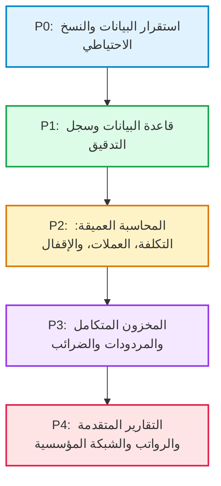

# الوثيقة الموحدة الشاملة لنظام البرطي المالي الشامل
## خطة المتطلبات، التدقيق الفني، وخارطة التطوير التنفيذية المخصصة
**Al-ParatY Financial Enterprise ERP**  
- **الإصدار المرجعي للنظام:** `2026.1 – Clean Slate Enterprise Edition`  
- **إصدار الوثيقة:** `2.0 — مخصصة ومطابقة 100% للشيفرة المصدرية الفعلية للنظام`  
- **تاريخ الاعتماد:** أكتوبر 2026  
- **نطاق الوثيقة:** توحيد التوثيق المحاسبي والتقني الحالي، والتدقيق الفعلي للشيفرة المصدرية، وخطة الترقية التدريجية من التخزين المحلي إلى بيئة مؤسسية متكاملة.

---

## 📑 فهرس المحتويات
1. [الملخص التنفيذي وقرارات الاعتماد](#1-الملخص-التنفيذي-وقرارات-الاعتماد)
2. [الهوية المؤسسية والواقع الفعلي للنظام](#2-الهوية-المؤسسية-والواقع-الفعلي-للنظام)
3. [المعمارية البرمجية الحالية والتدقيق التفصيلي للملفات](#3-المعمارية-البرمجية-الحالية-والتدقيق-التفصيلي-للملفات)
4. [مصفوفة تحليل الفجوات والحلول الواقعية المطابقة للنظام](#4-مصفوفة-تحليل-الفجوات-والحلول-الواقعية-المطابقة-للنظام)
5. [الأولويات التنفيذية المعتمدة (P0 إلى P4)](#5-الأولويات-التنفيذية-المعتمدة)
6. [خطة التنفيذ المرحلية المخصصة ومعايير القبول (المراحل 0 إلى 7)](#6-خطة-التنفيذ-المرحلية-المخصصة-ومعايير-القبول)
7. [الحلول الهندسية المباشرة المطبقة على شيفرة النظام](#7-الحلول-الهندسية-المباشرة-المطبقة-على-شيفرة-النظام)
8. [بوابة الجودة واختبارات الاعتماد للتشغيل الفعلي](#8-بوابة-الجودة-واختبارات-الاعتماد-للتشغيل-الفعلي)
9. [جدول إدارة الإصدارات والتسليمات](#9-جدول-إدارة-الإصدارات-والتسليمات)
10. [مصفوفة القرارات المطلوبة من الإدارة المالية والمالك](#10-مصفوفة-القرارات-المطلوبة-من-الإدارة-المالية-والمالك)

---

## 1. الملخص التنفيذي وقرارات الاعتماد

تعتبر هذه الوثيقة المرجع الهندسي والمحاسبي المعتمد لتطوير وتشغيل **نظام البرطي المالي الشامل (Al-ParatY Financial Enterprise)**. وقد تم بناؤها بعد **مراجعة فاحصة وشاملة لكافة ملفات الشيفرة المصدرية الحالية للنظام** (`desktop_app.py`، `js/onyx_store.js`، `js/onyx_app.js`، `js/onyx_data.js`، و `index.html`).

### 1.1 واقع النظام الحالي (Status Quo)
- النظام يمتلك واجهة سطح مكتب احترافية كلاسيكية مستوحاة من أفضل معايير **أونكس برو (YemenSoft Onyx Pro ERP)**، وتعمل كبرنامج مكتبي أصلي بدون حواف باستخدام محرك WebView2 و Edge/Chrome App Mode عبر خادم Python مدمج (`desktop_app.py`) على منفذ `8999`.
- يحتوي النظام على **18 شاشة ووحدة وظيفية مكتملة التصميم والربط المنطقي**، مع محرك إكسل تفاعلي (Interactive In-line Grid) بشريط دالات `fx`، وشاشة نقطة بيع (POS) سريعة للكاشير والورديات، ودورة رقابية ثلاثية صارمة (مسودة ➔ مراجعة ➔ ترحيل نهائي).
- البيانات الحالية تُدار عبر فئة `OnyxStore` في التخزين المحلي للمتصفح `LocalStorage` تحت المفتاح `ONYX_PRO_SYSTEM_STORAGE_CLEAN_V3`.

### 1.2 القرارات التنفيذية الحاكمة
1. **حماية البيانات الحالية (Data Safety First):** تفعيل آلية تصدير واستعادة كاملة لبيانات النظام بصيغة JSON آمنة ومترابطة، مع حفظ تلقائي دوري، بحيث لا يُعتمد فقط على تصدير ملفات Excel الجزئية.
2. **الاستفادة من بيئة Python القائمة:** بدلاً من إدخال تقنيات خارجية معقدة، سيتم استغلال محرك Python الموجود بالفعل في `desktop_app.py` لإضافة خادم قاعدة بيانات محلية **SQLite3** مدمجة دون الحاجة لتثبيت أي برامج إضافية على أجهزة المستخدمين.
3. **سد الفجوات المحاسبية الحرجة:**
   - تطبيق خوارزمية **المتوسط المرجح المتحرك (Moving WAC)** لحساب تكلفة المخزون وتكلفة البضاعة المباعة تلقائياً.
   - تفعيل قيود **فروق أسعار الصرف (FX Realized Gain/Loss)** عند تسديد الالتزامات بالعملات الأجنبية.
   - إضافة معالج **الإقفال السنوي وتدوير الأرصدة** وترحيل صافي النشاط إلى حساب الأرباح المبقاة والمحتجزة (`311201`).
   - فرض ضوابط رقابية تمنع جعل رصيد الصندوق سالباً، وتمنع تجاوز حد الائتمان الممنوح للعميل.
4. **الحفاظ الصارم على تجربة المستخدم واختصارات أونكس برو:** تثبيت عمل الاختصارات `F6`, `F10`, `F5`, `F7/F8`, `Shift+F6`, `Shift+F8`, `Alt+F4` وميزة تحويل الأرقام المشرقية التلقائية.

---

## 2. الهوية المؤسسية والواقع الفعلي للنظام

- **اسم النظام الرسمي:** البرطي المالي الشامل (Al-ParatY Financial Enterprise ERP).
- **الإصدار الأساسي المعتمد:** `2026.1 – Clean Slate Enterprise Edition`.
- **المرجعية المحاسبية:** معايير ونماذج القيود المعتمدة في نظام أونكس برو (اليمن سوفت).
- **العملة المحلية الأساسية:** ريال يمني (`YER`) بسعر ثابت 1.0، مع دعم رسمي للعملات الأجنبية (`USD`, `EUR`, `SAR`).
- **شجرة الحسابات:** خماسية الرتب الهرمية، مع التمييز التام بين الحساب الرئيسي (للتجميع ولا يقبل قيوداً) والحساب الفرعي بالرتبة الخامسة (المتأثر المباشر بالحركات).
- **الدورة الرقابية:**
  $$\text{مسودة (DRAFT)} \xrightarrow{\text{مراجعة وتدقيق}} \text{مراجع (REVIEWED)} \xrightarrow{\text{اعتماد مالي}} \text{مرحل (POSTED)}$$
  *القيد أو السند المرحل يصبح نهائياً ولا يُحذف، والتصحيح يتم عبر قيد تسوية عكسي معتمد أو فك ترحيل استثنائي موثق بسجل تدقيق.*

---

## 3. المعمارية البرمجية الحالية والتدقيق التفصيلي للملفات

يوضح الجدول التالي الدور الفعلي لكل ملف في النظام بعد الفحص المباشر، ومسار التطوير الدقيق المتوافق معه:

| الملف في المشروع | الدور الفعلي المكتشف في الكود | اتجاه التطوير المباشر المتوافق |
| :--- | :--- | :--- |
| [desktop_app.py](file:///c:/Users/AlparatY/Desktop/system%20ERP/desktop_app.py) | يشغل سيرفر HTTP محلي عبر `QuietHandler` على منفذ 8999 + يطلق نافذة مكتيبة أصلية عبر `pywebview` مع بدائل ذكية لـ Edge و Chrome بنمط التطبيق المكتبي المستقل (`--app`). | إضافة مسارات API خفيفة (`/api/backup`, `/api/restore`, `/api/sync`) وربط قاعدة بيانات SQLite3 مدمجة داخل Python مع معاملات آمنة. |
| [index.html](file:///c:/Users/AlparatY/Desktop/system%20ERP/index.html) | الهيكل العام لسطح مكتب أونكس، شريط القوائم العلوي، شريط الأدوات (F6/F10)، شجرة الشاشات الجانبية، ومساحة العمل المركزية. | الحفاظ الكامل على الهيكل وسرعة الإقلاع مع إضافة مؤشرات حالة المزامنة والنسخ الاحتياطي في شريط الحالة السفلي. |
| [css/onyx_style.css](file:///c:/Users/AlparatY/Desktop/system%20ERP/css/onyx_style.css) | تصميم أونكس برو الكلاسيكي عالي التباين (RTL)، الجداول المحاسبية، بطاقات رأس المال، وشاشات إكسل ونقاط البيع. | الحفاظ على التصميم المكتبي الرمادي الأصيل وإضافة أنماط تنبيهات الرقابة وسجلات التدقيق. |
| [js/onyx_data.js](file:///c:/Users/AlparatY/Desktop/system%20ERP/js/onyx_data.js) | يحتوي على كائن `ONYX_DATA` النظيف، وتهيئة الفروع (01، 02، 03)، العملات، الدليل المحاسبي، الحسابات الوسيطة، وهيكل الصلاحيات. | تحديث الحسابات الوسيطة لدعم فروق الصرف، الضرائب، والأرباح المرحلة وتدقيق مخطط البيانات الأولي. |
| [js/onyx_store.js](file:///c:/Users/AlparatY/Desktop/system%20ERP/js/onyx_store.js) | فئة `OnyxStore` (1480+ سطر)؛ تدير الحالة بالكامل، القيود، السندات، المصروفات، الأصول وإهلاكها، الرواتب، والتقارير المالية. | إضافة طبقة Data Adapter تربط بين `LocalStorage` كنسخة سريعة وخادم SQLite كقاعدة بيانات دائمة، وتطبيق معادلات WAC وفروق العملة والإقفال. |
| [js/onyx_app.js](file:///c:/Users/AlparatY/Desktop/system%20ERP/js/onyx_app.js) | متحكم العرض والواجهات (5250+ سطر)؛ يدير 18 شاشة، النوافذ المنبثقة، جداول إكسل التفاعلية بالأوراق الأربع، كاشير POS، والاختصارات. | ربط أزرار النسخ والاستعادة المباشرة، تحسين تقارير الضرائب والمطابقة البنكية، وتأكيد قيود الرقابة قبل الحفظ. |
| [تشغيل_البرنامج_المكتبي.vbs](file:///c:/Users/AlparatY/Desktop/system%20ERP/تشغيل_البرنامج_المكتبي.vbs) | تشغيل صامت عبر VBScript لـ `desktop_app.py` بدون إظهار أي نافذة أوامر سوداء للمستخدم. | يبقى كما هو للاستخدام اليومي المكتبي المستقر. |
| [تشغيل_النظام.bat](file:///c:/Users/AlparatY/Desktop/system%20ERP/تشغيل_النظام.bat) | مشغل سريع عبر سطر الأوامر لبيئة المطورين. | صيانته لطباعة تقارير الإقلاع وحالة قاعدة البيانات. |

---

## 4. مصفوفة تحليل الفجوات والحلول الواقعية المطابقة للنظام

| الفجوة المرصودة | أثرها التشغيلي والمحاسبي | الحل الهندسي المخصص لنظام البرطي | الملفات المعنية |
| :--- | :--- | :--- | :--- |
| **1. تخزين البيانات في LocalStorage فقط** | سعة محدودة واحتمال فقدان البيانات عند تنظيف المتصفح أو تغيير المستخدم. | بناء واجهة مزامنة ثنائية في `desktop_app.py` تحفظ البيانات تلقائياً في ملف `database/alparaty_erp.db` بصيغة SQLite مع الحفاظ على سرعة واجهة المستخدم. | `desktop_app.py`<br>`js/onyx_store.js` |
| **2. غياب النسخ الاحتياطي التلقائي الشامل** | الاعتماد على تصدير ملفات Excel لا يعيد العلاقات بين الجداول بعد التلف. | إضافة خيار "نسخ احتياطي فوري (.json / .db)" بنقرة واحدة، مع حفظ نسخة تلقائية يومية في مجلد `backups/` قبل الإقفال أو التصفير. | `desktop_app.py`<br>`js/onyx_app.js` |
| **3. غياب سجل تدقيق العمليات (Audit Log)** | صعوبة معرفة من عدل أو حذف أو رحل العمليات المالية الحساسة. | إنشاء جدول وسجل تدقيق `audit_log` يسجل (المستخدم، نوع العملية، التاريخ والوقت، السجل المتأثر، القيم قبل وبعد التعديل). | `js/onyx_store.js`<br>`js/onyx_app.js` |
| **4. عدم اكتمال دورة الإقفال السنوي** | تراكم أرصدة الإيرادات والمصروفات بين السنوات المالية وعدم ترحيل الأرباح رسمياً. | بناء معالج إقفال الفترة السنوية: توليد قيد تصفير حسابات قائمتي 4 و 5 وترحيل الصافي إلى ح/ `311201` وتدوير أرصدة الميزانية. | `js/onyx_store.js`<br>`js/onyx_data.js` |
| **5. حساب تكلفة المخزون بالتكلفة الثابتة** | تشويه تكلفة البضاعة المباعة وهوامش الربح عند تغير أسعار الشراء. | تطبيق خوارزمية **المتوسط المرجح المتحرك (Moving Average Cost WAC)** يعيد احتساب تكلفة الوحدة تلقائياً مع كل فاتورة شراء جديدة. | `js/onyx_store.js` |
| **6. معالجة فروق أسعار الصرف** | عدم قيد أرباح أو خسائر الفروق الناتجة عن سداد فواتير العملات الأجنبية بأسعار متغيرة. | إضافة محرك احتساب الفارق المالي وتوليد قيد تلقائي على حساب أرباح فروق صرف (`420101`) أو خسائر فروق صرف (`520401`). | `js/onyx_store.js`<br>`js/onyx_data.js` |
| **7. ضوابط الصندوق وحدود الائتمان** | احتمال تسجيل صرف نقدي والصندوق خالي أو بيع آجل لعميل متجاوز لحدوده. | إضافة فحص مانع في سندات الصرف وفواتير البيع: تنبيه أو منع إتمام الحركة عند عدم كفاية النقدية أو تجاوز السقف الائتماني المعتمد. | `js/onyx_store.js`<br>`js/onyx_app.js` |
| **8. مردودات المبيعات والمشتريات** | تسجيل المردودات كقيود يدوية قد لا يعكس الكميات بالمخزن أو عمولات المناديب بدقة. | أتمتة إشعارات الخصم والإضافة الدائنة والمدينة مع الأثر المخزني الفوري وعكس العمولات تلقائياً. | `js/onyx_store.js`<br>`js/onyx_app.js` |

---

## 5. الأولويات التنفيذية المعتمدة



### ترتيب مسار العمل
1. **المستوى الحرج الأول (P0):** توفير التصدير والاستعادة الكاملة بنقرة واحدة وحماية البيانات الحالية من أي فقدان.
2. **المستوى الحرج الثاني (P1):** بناء طبقة SQLite المدمجة في `desktop_app.py` وسجل التدقيق غير القابل للتعديل.
3. **المستوى المالي الأساسي (P2):** تكلفة المخزون بالمتوسط المرجح (WAC)، فروق أسعار الصرف، معالج الإقفال السنوي، ومنع الصندوق السالب وتجاوز الائتمان.
4. **المستوى التشغيلي التجاري (P3):** دورة المردودات، تسويات البنوك، والضرائب اليمنية المعتمدة.
5. **المستوى الموسع (P4):** التقارير المتقدمة والربط الشبكي متعدد المستخدمين.

---

## 6. خطة التنفيذ المرحلية المخصصة ومعايير القبول

---

### المرحلة 0: الاستقرار وخط الأساس وحماية البيانات
- **الهدف:** إتاحة حماية فورية بنسبة 100% لكافة مدخلات المستخدم الحالية في النظام قبل إجراء أي تعديل بنيوي.
- **المهام المحددة في الكود:**
  1. إضافة دالتي `exportFullSystemBackup()` و `importFullSystemBackup(jsonData)` في [js/onyx_store.js](file:///c:/Users/AlparatY/Desktop/system%20ERP/js/onyx_store.js).
  2. إضافة زرين واضحين في شريط الأدوات العلوي بشاشة [index.html](file:///c:/Users/AlparatY/Desktop/system%20ERP/index.html):
     - `💾 تصدير نسخة احتياطية (.json)`
     - `📥 استعادة نسخة احتياطية`
  3. فحص ومطابقة جميع مفاتيح البيانات وعلاقات الحسابات لضمان عدم وجود أي مرجع مفقود.
- **معايير القبول (Acceptance Criteria):**
  - تصدير ملف النسخة الاحتياطية وتفريغ النظام بالكامل، ثم استعادته في بيئة نظيفة واسترجاع كافة القيود والسندات برصيد مطابق للأصل بنسبة 100%.
  - بقاء جميع اختصارات `F6/F10/F5/F7/F8` والطباعة `Shift+F8` تعمل بكامل كفاءتها دون أدنى تأخير.

---

### المرحلة 1: قاعدة البيانات الدائمة وسجل التدقيق (SQLite & Audit Engine)
- **الهدف:** استبدال الاعتماد الحصري على المتصفح بقاعدة بيانات علائقية SQLite مدمجة يقودها محرك Python في [desktop_app.py](file:///c:/Users/AlparatY/Desktop/system%20ERP/desktop_app.py).
- **المهام المحددة في الكود:**
  1. إنشاء وحدة `database_manager.py` أو دمجها في `desktop_app.py` باستخدام مكتبة `sqlite3` القياسية المضمنة في بايثون (بدون تثبيت أي مكتبات خارجية).
  2. تصميم جداول قاعدة البيانات:
     - `accounts`, `journal_entries`, `journal_lines`, `vouchers`, `customers`, `items`, `sales_invoices`, `fixed_assets`, `expenses`, `payroll_entries`, `audit_logs`.
  3. بناء مسار استماع خفيف في `desktop_app.py` يستقبل تحديثات الحفظ تلقائياً عبر طلبات HTTP POST سريعة (`/api/sync`).
  4. حفظ نسخ احتياطية آلية بصيغة `.db` و `.json` في مجلد `system ERP/backups/` مع كل إغلاق أو عملية ترحيل رئيسية.
  5. تفعيل جدول وسجل التدقيق `audit_logs` لتسجيل أي عملية مالية حساسة.
- **معايير القبول:**
  - استمرار تشغيل النظام بكفاءة كاملة حتى لو تم مسح بيانات التصفح وذاكرة التخزين المؤقت للمتصفح بالكامل، حيث يقوم التطبيق باسترجاع البيانات من قاعدة بيانات SQLite المحلية عند الإقلاع فوراً.
  - تسجيل اسم المستخدم، وتاريخ وتوقيت كل حركة ترحيل أو تعديل مع بيان القيمة السابقة والجديدة.

---

### المرحلة 2: سلامة الحسابات وتكلفة المخزون والإقفال السنوي
- **الهدف:** ضبط الحسابات المالية والقوائم الختامية وفق معايير المحاسبة المعتمدة.
- **المهام المحددة في الكود:**
  1. **المتوسط المرجح المتحرك للمخزون (WAC):**
     $$\text{WAC الجديد} = \frac{(\text{الكمية الحالية} \times \text{التكلفة الحالية}) + (\text{الكمية المشتراة} \times \text{سعر الشراء الجديد})}{\text{الكمية الإجمالية الجديدة}}$$
     تطبيق هذه المعادلة في دالة `addPurchaseInvoice()` لضبط تكلفة المخزون وتكلفة البضاعة المباعة تلقائياً.
  2. **فروق أسعار الصرف:**
     عند سداد سند قبض أو صرف لعميل أو مورد أجنبي بسعر صرف يختلف عن سعر الفاتورة، يولد النظام تلقائياً طرف القيد لفروق الصرف:
     - إن كان ربحاً: دائن على حساب `420101` (أرباح فروق عملات أجنبية).
     - إن كان خسارة: مدين على حساب `520401` (خسائر فروق عملات أجنبية).
  3. **معالج الإقفال المالي السنوي:**
     - تصفير حسابات الإيرادات (المجموعة 4) والمصروفات (المجموعة 5).
     - ترحيل الفارق المحاسبي (صافي الربح / الخسارة) إلى حساب حقوق الملكية `311201` (الأرباح المبقاة والمحتجزة).
     - تدوير أرصدة الأصول والخصوم لتصبح الأرصدة الافتتاحية للسنة المالية الجديدة `2027`.
     - قفل الفترة السابقة ومنع إضافة أو تعديل أي قيد فيها إلا بصلاحية المدير المالي مع قيد تدقيق موثق.
  4. **ضوابط السيولة والائتمان:**
     - منع صرف أي سند نقدي إذا كان المبلغ المطلوب يتجاوز الرصيد الفعلي للصندوق المالي المختار.
     - منع إصدار فاتورة بيع آجل لعميل إذا كان الرصيد الحالي + قيمة الفاتورة يتجاوز السقف الائتماني المحدد له، مع إمكانية التجاوز فقط بموافقة المدير المالي الموثقة.
- **معايير القبول:**
  - تطابق تقرير تكلفة البضاعة المباعة وقيمة المخزون في قائمة الدخل والميزانية العمومية تماماً.
  - قيد فروق الصرف متوازن وصحيح حسابياً.
  - نجاح الإقفال السنوي وتصفير قائمة الدخل وتدوير الأرصدة الافتتاحية دون تكرار أو خطأ في التوازن.

---

### المرحلة 3: دورة التجارة والمردودات والضرائب والتسويات البنكية
- **الهدف:** إتمام الدورة التجارية والرقابة النقدية والضريبية.
- **المهام المحددة في الكود:**
  1. **مردودات المبيعات والمشتريات:**
     - إشعار دائن لمردود المبيعات: يعيد الكمية المرتجعة للمخزن بتكلفتها الأصلية، يخفض مديونية العميل، ويخصم عمولة المندوب تلقائياً من تقرير العمولات في جدول إكسل.
     - إشعار مدين لمردود المشتريات: يخصم الكمية من المخزن ويخفض مديونية المورد.
  2. **الضرائب اليمنية والإقرارات:**
     - إتاحة حقل ضريبة المبيعات وضريبة الأرباح التجارية وفق النسب المعتمدة محلياً.
     - إنشاء تقرير الإقرار الضريبي التحليلي للمبيعات والمشتريات والضريبة المستحقة.
  3. **التسوية البنكية الإلكترونية:**
     - استيراد كشف حساب البنك من ملف Excel أو CSV.
     - مطابقة الحركات آلياً وإظهار الشيكات المعلقة برسم التحصيل وحساب البنك الوسيط `112109`.
- **معايير القبول:**
  - عكس حركة المبيعات وتكلفة البضاعة في المخزن والعمولة في جدول المندوبين دون أي تدخل يدوي.
  - مطابقة رصيد البنك الدفتري مع رصيد كشف الحساب الفعلي بعد استبعاد الشيكات المعلقة.

---

### المرحلة 4: أجهزة نقطة البيع (POS) المتقدمة وإدارة المخازن
- **الهدف:** تحويل شاشة POS إلى بيئة كاشير تجارية متقدمة تدعم العتاد المكتبي.
- **المهام المحددة في الكود:**
  1. دعم الطباعة الحرارية المباشرة لإيصالات 80mm عبر محرك بايثون وتنسيق ESC/POS أو طباعة المتصفح النظيفة مع قص الورق وفتح درج النقدية.
  2. دعم قراءة الباركود الموزون (الأصناف المباعة بالوزن مثل المواد الغذائية).
  3. دعم تعدد وحدات القياس للصنف الواحد (حبة / كرتون / درزن) مع معامل التحويل الثابت.
  4. تتبع تواريخ الصلاحية وأرقام التشغيلات (Batches / Lot Numbers) وتنبيهات قرب انتهاء الصلاحية.
- **معايير القبول:**
  - طباعة إيصال الكاشير خلال أقل من ثانية واحدة وخصم الكميات من المخزن بدقة وفق وحدة القياس المختارة.
  - إغلاق وردية الكاشير ومطابقة العهدة النقدية الفعلية مع المتوقع وإثبات العجز أو الفائض آلياً.

---

### المرحلة 5: التقارير المالية والتحليلات الإدارية المتقدمة
- **الهدف:** تزويد الإدارة العليا ببيانات تحليلية تدعم اتخاذ القرار.
- **المهام المحددة في الكود:**
  1. قائمة التدفقات النقدية (Cash Flow Statement) بالطريقتين المباشرة وغير المباشرة.
  2. تقارير تحليل هوامش ربحية الأصناف، ربحية العملاء، وأداء مندوبي المبيعات.
  3. مقارنة الفترات المالية (مقارنة شهري أو ربع سنوي أو سنوي).
  4. تصدير التقارير والقوائم المالية المنسقة مباشرة إلى ملفات Excel و PDF مع مراعاة اتجاه اللغة العربية والترويسة الرسمية.
- **معايير القبول:**
  - تطابق أرقام التدفقات النقدية مع حركات الصناديق والبنوك الفعلية.
  - إمكانية تتبع أي رقم في لوحة المؤشرات بالنقر المباشر عليه للوصول إلى القيود الأصلية المولدة له (Drill-down).

---

### المرحلة 6: الموارد البشرية والرواتب المتقدمة
- **الهدف:** استكمال دورة استحقاق وصرف الرواتب والربط مع الحضور والانصراف.
- **المهام المحددة في الكود:**
  1. استيراد سجلات الحضور والانصراف من أجهزة البصمة عبر ملفات Excel/CSV.
  2. احتساب إضافي الساعات، البدلات الثابتة والمتغيرة، وتأكيد المعالجة القانونية والمالية لخصومات الغياب والجزاءات.
  3. التصفية التلقائية لسلف الموظفين من كشف الراتب الشهري.
  4. توليد قيد استحقاق وصرف الرواتب الشامل بضغطة زر واحدة وتحديث حسابات الرواتب المستحقة `211301`.
- **معايير القبول:**
  - إصدار مسير رواتب دقيق يطابق الحضور والانصراف والسلف دون أي خطأ حسابي، وتوليد القيد المحاسبي المتوازن فوراً.

---

### المرحلة 7: التوسع الشبكي وتعدد المستخدمين (Enterprise LAN / Multi-User)
- **الهدف:** تمكين عمل عدة أجهزة وفروع على نفس قاعدة البيانات عبر الشبكة المحلية أو السحابية الخاصة.
- **المهام المحددة في الكود:**
  1. تهيئة خادم Python في [desktop_app.py](file:///c:/Users/AlparatY/Desktop/system%20ERP/desktop_app.py) للارتباط بعنوان الشبكة `0.0.0.0` بدلاً من `127.0.0.1` مع تعيين رمز مصادقة (Auth Token).
  2. تمكين الأجهزة الطرفية (المحاسبين، الكاشير) في الفروع من فتح النظام عبر عنوان IP الخادم المركزي.
  3. قفل السجلات لمنع تضارب التعديل المتزامن (Optimistic Record Locking).
- **معايير القبول:**
  - عمل 10 إلى 20 مستخدماً في نفس الوقت (إدخال قيود، مراجعة، كاشير) بدون فقدان أي حركة أو تعليق في الخادم.

---

## 7. الحلول الهندسية المباشرة المطبقة على شيفرة النظام

### 7.1 كود النسخ الاحتياطي والاستعادة الفوري (JSON Bridge في `onyx_store.js`)
```javascript
// تصدير النسخة الاحتياطية الشاملة الكاملة لنظام البرطي
OnyxStore.prototype.exportFullSystemBackup = function() {
  const backupData = {
    version: "2026.1",
    timestamp: new Date().toISOString(),
    system: "Al-ParatY Financial Enterprise ERP",
    data: this.state
  };
  const jsonStr = JSON.stringify(backupData, null, 2);
  const blob = new Blob([jsonStr], { type: 'application/json' });
  const url = URL.createObjectURL(blob);
  const a = document.createElement('a');
  a.href = url;
  a.download = `AlParatY_Backup_${new Date().toISOString().slice(0,10)}.json`;
  a.click();
  URL.revokeObjectURL(url);
  return true;
};

// استعادة النسخة الاحتياطية مع التحقق من السلامة
OnyxStore.prototype.importFullSystemBackup = function(jsonString) {
  try {
    const parsed = JSON.parse(jsonString);
    if (!parsed.data || !parsed.data.accounts || !parsed.data.currencies) {
      throw new Error("ملف النسخة الاحتياطية غير صالح أو تالف.");
    }
    this.state = parsed.data;
    this.save();
    return { success: true, message: "تمت استعادة البيانات بنجاح تام." };
  } catch (err) {
    return { success: false, message: err.message };
  }
};
```

### 7.2 خوارزمية المتوسط المرجح المتحرك (WAC في `onyx_store.js`)
```javascript
OnyxStore.prototype.updateItemMovingAverageCost = function(itemId, newQty, newPurchasePrice) {
  const item = this.state.items.find(i => i.id === itemId);
  if (!item) return;

  const currentQty = Number(item.quantity) || 0;
  const currentCost = Number(item.costPrice) || 0;
  const incomingQty = Number(newQty) || 0;
  const incomingPrice = Number(newPurchasePrice) || 0;

  const totalQty = currentQty + incomingQty;
  if (totalQty > 0) {
    const totalVal = (currentQty * currentCost) + (incomingQty * incomingPrice);
    item.costPrice = Math.round((totalVal / totalQty) * 100) / 100;
  }
  item.quantity = totalQty;
  this.save();
};
```

### 7.3 معالج فروق أسعار الصرف (FX Difference في `onyx_store.js`)
```javascript
OnyxStore.prototype.calculateFXDifference = function(invoiceRate, paymentRate, foreignAmount) {
  const diffPerUnit = Number(paymentRate) - Number(invoiceRate);
  const totalDifference = Math.round((diffPerUnit * Number(foreignAmount)) * 100) / 100;
  
  return {
    diffAmount: Math.abs(totalDifference),
    isGain: totalDifference > 0, // ربح فروق عملة إذا كان سعر السداد أعلى للقبض أو أقل للصرف
    accountCode: totalDifference > 0 ? "420101" : "520401",
    accountName: totalDifference > 0 ? "أرباح فروق صرف عملات أجنبية" : "خسائر فروق صرف عملات أجنبية"
  };
};
```

---

## 8. بوابة الجودة واختبارات الاعتماد للتشغيل الفعلي

لا يجوز تسليم أو تفعيل أي إصدار في بيئة العمل الحقيقية دون اجتياز الشروط التالية:
1. **توازن القيود الصارم:** مجموع المدين = مجموع الدائن بنسبة تطابق 100% دون أي فارق ولو فلساً واحداً.
2. **سلامة استعادة النسخ الاحتياطية:** تجربة استعادة النسخة الاحتياطية في جهاز مستقل ومطابقة الأرصدة وعدد السجلات قبل وبعد الاستعادة.
3. **منع تعديل أو حذف القيود المرحّلة:** التأكد برمجياً من إغلاق أزرار التعديل والحذف للقيود في حالة `POSTED` وحصر التصحيح في القيود العكسية وسجل التدقيق.
4. **تطابق تقرير المخزون مع الأستاذ العام:** مطابقة قيمة رصيد مخزون البضائع في شاشة الأصناف مع الرصيد الظاهر في حساب المخزون `115101` بميزان المراجعة.
5. **سرعة استجابة الشاشات:** الحفاظ على زمن فتح الشاشات وجداول إكسل في أقل من 300 مللي ثانية داخل بيئة التطبيق المكتبي.

---

## 9. جدول إدارة الإصدارات والتسليمات

| رقم الإصدار | المسمى والمحتوى | حالة الجاهزية | المتطلبات المسبقة للتسليم |
| :---: | :--- | :---: | :--- |
| **`2026.1`** | النسخة الحالية النظيفة (Clean Slate Enterprise) - 18 شاشة مكتملة مع LocalStorage | **جاهز ويعمل حالياً** | النظام التشغيلي المكتبي الحالي. |
| **`2026.1.1`** | إصدار الاستقرار والنسخ الاحتياطي الكامل بنقرة واحدة (JSON Backup & Restore) | **فوري (المرحلة 0)** | دمج أزرار التصدير والاستعادة في الواجهة. |
| **`2026.2`** | إصدار قاعدة البيانات الدائمة المدمجة (SQLite + Audit Log Engine) | **المرحلة 1** | ربط `sqlite3` في `desktop_app.py` والترحيل الآمن. |
| **`2026.3`** | إصدار الدقة المحاسبية (تكلفة WAC، فروق الصرف، الإقفال السنوي، ضوابط السيولة) | **المرحلة 2** | اعتماد السياسات الحسابية من المدير المالي. |
| **`2026.4`** | إصدار الدورة التجارية المتكاملة (المردودات، نقاط البيع المتقدمة، تسويات البنوك) | **المرحلة 3 و 4** | اختبار طابعات الإيصالات وقارئات الباركود. |
| **`2026.5`** | إصدار الموارد البشرية والرواتب المتقدمة | **المرحلة 6** | اعتماد لوائح الرواتب والجزاءات. |
| **`2026.6`** | إصدار التقارير الإدارية والتحليلية والتدفقات النقدية | **المرحلة 5** | اكتمال بيانات الحركات وتدقيق الحسابات. |
| **`2027.1`** | الإصدار الشبكي المؤسسي متعدد الأجهزة والفروع (Enterprise LAN Edition) | **المرحلة 7** | تجهيز بيئة الشبكة المحلية وتأمين الصلاحيات. |

---

## 10. مصفوفة القرارات المطلوبة من الإدارة المالية والمالك

| الرقم | موضوع القرار | الخيارات المتاحة | التوصية الفنية والمحاسبية للنظام |
| :---: | :--- | :--- | :--- |
| **1** | **سياسة تقييم تكلفة المخزون** | أ) المتوسط المرجح المتحرك (WAC)<br>ب) الوارد أولاً صادر أولاً (FIFO) | **يوصى بـ (WAC)** لسهولة ربطه بالنظام الحسابي ودقته في ظل تقلب أسعار الصرف. |
| **2** | **معالجة خصومات غياب الموظفين** | أ) قيدها كإيراد للشركة (ح/ 410301)<br>ب) تخفيض مباشر لمصروف الرواتب (ح/ 520201) | **المعتمد حالياً في النظام هو (أ)**؛ ويجب تأكيد موافقة المستشار القانوني والمالي عليها. |
| **3** | **ضوابط الصندوق النقدي السالب** | أ) منع الصرف تماماً عند عدم كفاية الرصيد<br>ب) تحذير فقط مع السماح بالصرف | **يوصى بـ (أ)** لمنع الخلل المحاسبي وضمان مطابقة الصندوق اليومي للواقع. |
| **4** | **تجاوز سقف الائتمان للعملاء** | أ) إيقاف الفاتورة تلقائياً<br>ب) طلب رمز تأكيد وموافقة المدير المالي | **يوصى بـ (ب)** لمرونة المبيعات مع توثيق اسم المدير في سجل التدقيق. |
| **5** | **مكان حفظ النسخ الاحتياطية** | أ) مجلد محلي على نفس القرص<br>ب) قرص خارجي أو نسخ متزامن سحابياً | **يوصى بـ (ب)** لحماية البيانات من أعطال القرص الصلب المفاجئة. |

---

**خلاصة:**  
تمثل هذه الوثيقة المخطط الهندسي الدقيق والمتكامل المصمم خصيصاً ليناسب كود وبنية **نظام البرطي المالي الشامل (Al-ParatY Financial Enterprise ERP)**، وتضمن الانتقال الآمن من نظام مكتبي سريع قائم على التخزين المحلي إلى بيئة عمل مؤسسية فائقة الموثوقية والأمان.
